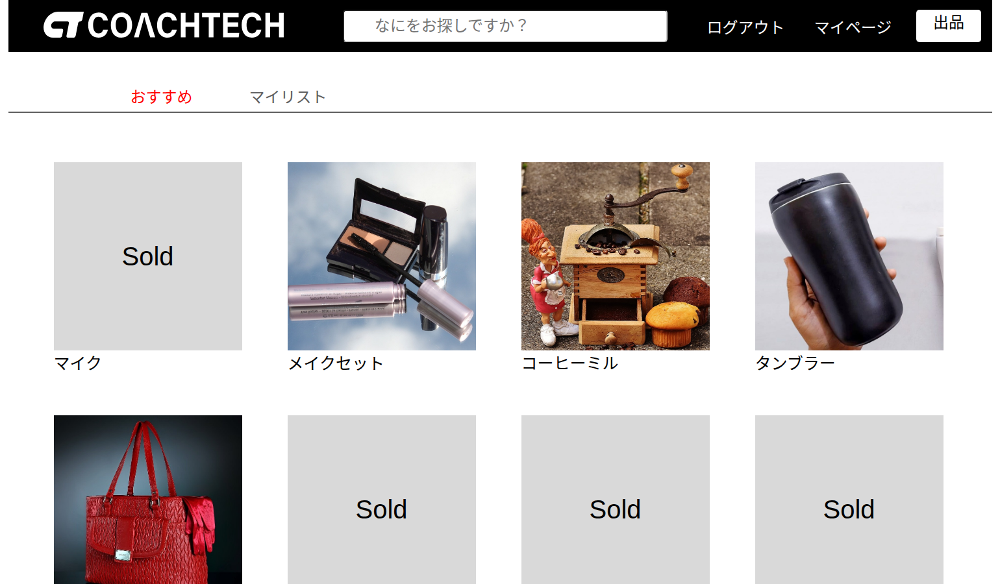
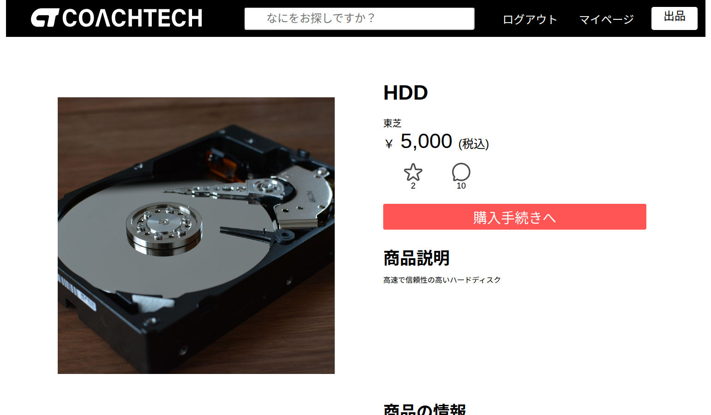
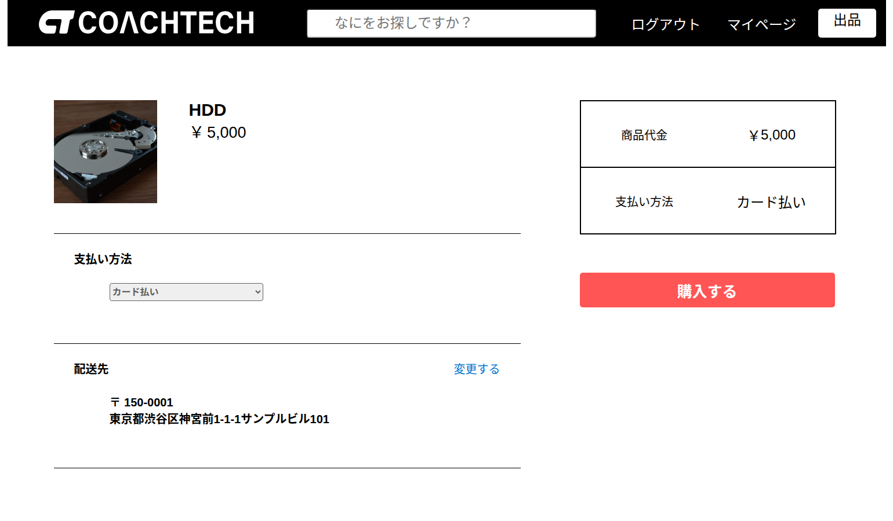
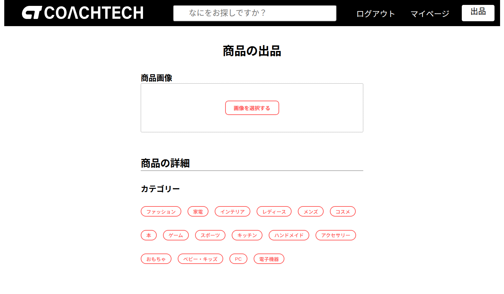

# coachtech-flea-market

[](https://github.com/seiya71/coachtech-flea-market/actions/workflows/test.yml)

## アプリの概要
個人どうしで商品を売り買いできるフリマアプリです。
会員登録をすると、商品の出品、いいね、コメント、購入ができます。
支払いは Stripe を使い、カード払いとコンビニ払いに対応しています。

## 機能一覧
| 分類 | 機能 |
|---|---|
| 会員 | 会員登録、ログイン・ログアウト、メール認証、プロフィールの編集（画像・住所） |
| 商品を探す | 商品一覧、商品名での検索、マイリスト（いいねした商品）、商品詳細、売り切れの表示 |
| 交流 | いいね、コメント |
| 出品 | 商品画像のアップロード、カテゴリ（複数選択）・状態・価格の入力 |
| 購入 | 支払い方法の選択（カード払い・コンビニ払い）、配送先の変更、Stripe Checkout での決済 |
| マイページ | 出品した商品・購入した商品の一覧 |

## 画面
| 商品一覧 | 商品詳細 |
|---|---|
|  |  |

| 購入 | 出品 |
|---|---|
|  |  |

## 工夫した点
- **決済の結果を Stripe Webhook で反映**
  決済完了画面を開いたときだけ購入を記録していたため、ブラウザを閉じるとお金だけ引かれる不具合がありました。
  Stripe からの通知（Webhook）で購入を記録するように直し、あとから支払うコンビニ払いの入金・期限切れや、売り切れ後に支払われた場合の自動返金にも対応しました。
- **同時に購入されても二重に売れないようにする**
  購入の記録はトランザクションと行ロック（`lockForUpdate`）で行い、さらにデータベースのユニーク制約で、同じ商品の購入やいいねが重複しないようにしました。
- **セキュリティ対策**
  ログインの試行回数の制限、メール認証を済ませていない人の操作の制限、画像パスの書き換えの防止、価格の上限・下限のチェックを行っています。
- **購入時の配送先を保存**
  購入した時点の配送先を記録するので、あとで住所を変えても過去の購入の配送先は変わりません。
- **テストと CI**
  機能ごとに Feature テストを書き（94件）、GitHub Actions で PR のたびに自動で実行しています。テストが通らないと `main` にマージできない設定にしています。

## 環境構築
**Dockerビルド**
1. `git clone git@github.com:seiya71/coachtech-flea-market.git`
2. `cd coachtech-flea-market`
3. `mkdir -p docker/mysql/data`
4. `docker compose up -d --build`
> *コマンドは Docker Compose v2 の `docker compose` で書いています。古い v1 を使っている場合は `docker-compose` に読み替えてください。*

> *MacのM1・M2チップのPCの場合、`no matching manifest for linux/arm64/v8 in the manifest list entries`のメッセージが表示されビルドができないことがあります。
エラーが発生する場合は、docker-compose.ymlファイルの「mysql」内に「platform」の項目を追加で記載してください*
``` bash
mysql:
    platform: linux/x86_64(この文追加)
    image: mysql:8.0.26
    environment:
```

**Laravel環境構築**

> *このプロジェクトでは、Webサーバー（php-fpm）は `www-data` ユーザーで動いています。
`storage` などに書き込む artisan コマンドは、`-u www-data` を付けて実行してください。
付けずに root で実行すると root が所有するファイルができ、Webサーバーが書き込めずに全ページが 500 エラーになることがあります。*

1. `docker compose exec php composer install`
2. `cp src/.env.example src/.env`
3. .envに以下の環境変数を追加
``` text
DB_CONNECTION=mysql
DB_HOST=mysql
DB_PORT=3306
DB_DATABASE=laravel_db
DB_USERNAME=laravel_user
DB_PASSWORD=laravel_pass

STRIPE_PUBLIC_KEY=pk_test_xxxxxxxx  # Stripeダッシュボードのテスト用公開キー
STRIPE_SECRET_KEY=sk_test_xxxxxxxx  # Stripeダッシュボードのテスト用シークレットキー
STRIPE_WEBHOOK_SECRET=whsec_xxxxxxxx  # 下の「Stripe Webhook の設定」で表示される署名シークレット

MAIL_MAILER=smtp
MAIL_HOST=sandbox.smtp.mailtrap.io
MAIL_PORT=2525
MAIL_USERNAME=your_mailtrap_username
MAIL_PASSWORD=your_mailtrap_password
MAIL_ENCRYPTION=tls
MAIL_FROM_ADDRESS=noreply@example.com
MAIL_FROM_NAME="${APP_NAME}"
```
4. 権限の調整

Webサーバー（`www-data`）が `storage` と `bootstrap/cache` に書き込めるようにします。
ファイルの持ち主は自分のままなので、ホスト側からも編集できます。
```bash
docker compose exec php chgrp -R www-data storage bootstrap/cache
docker compose exec php chmod -R g+rwX storage bootstrap/cache
docker compose exec php sh -c 'find storage bootstrap/cache -type d -exec chmod g+s {} +'
```
5. アプリケーションキーの作成
``` bash
docker compose exec php php artisan key:generate
```
6. `docker compose exec php php artisan storage:link`
7. キャッシュをクリア
```bash
docker compose exec -u www-data php php artisan config:clear
docker compose exec -u www-data php php artisan cache:clear
```
8. マイグレーションの実行
``` bash
docker compose exec -u www-data php php artisan migrate
```
9. シーディング用の商品画像の配置場所の作成
``` bash
mkdir -p src/storage/app/public/item_images
```
10. シーディング用の商品画像を設置

商品画像を `storage/app/public/item_images/` に保存する必要があります。  
以下を実行してください。
``` bash
curl -o src/storage/app/public/item_images/腕時計.png "https://coachtech-matter.s3.ap-northeast-1.amazonaws.com/image/Armani+Mens+Clock.jpg"

curl -o src/storage/app/public/item_images/HDD.png "https://coachtech-matter.s3.ap-northeast-1.amazonaws.com/image/HDD+Hard+Disk.jpg"

curl -o src/storage/app/public/item_images/玉ねぎ3束.png "https://coachtech-matter.s3.ap-northeast-1.amazonaws.com/image/iLoveIMG+d.jpg"

curl -o src/storage/app/public/item_images/革靴.png "https://coachtech-matter.s3.ap-northeast-1.amazonaws.com/image/Leather+Shoes+Product+Photo.jpg"

curl -o src/storage/app/public/item_images/ノートPC.png "https://coachtech-matter.s3.ap-northeast-1.amazonaws.com/image/Living+Room+Laptop.jpg"

curl -o src/storage/app/public/item_images/マイク.png "https://coachtech-matter.s3.ap-northeast-1.amazonaws.com/image/Music+Mic+4632231.jpg"

curl -o src/storage/app/public/item_images/ショルダーバッグ.png "https://coachtech-matter.s3.ap-northeast-1.amazonaws.com/image/Purse+fashion+pocket.jpg"

curl -o src/storage/app/public/item_images/タンブラー.png "https://coachtech-matter.s3.ap-northeast-1.amazonaws.com/image/Tumbler+souvenir.jpg"

curl -o src/storage/app/public/item_images/コーヒーミル.png "https://coachtech-matter.s3.ap-northeast-1.amazonaws.com/image/Waitress+with+Coffee+Grinder.jpg"

curl -o src/storage/app/public/item_images/メイクセット.png "https://coachtech-matter.s3.ap-northeast-1.amazonaws.com/image/%E5%A4%96%E5%87%BA%E3%83%A1%E3%82%A4%E3%82%AF%E3%82%A2%E3%83%83%E3%83%95%E3%82%9A%E3%82%BB%E3%83%83%E3%83%88.jpg"
```
11. シーディングの実行
``` bash
docker compose exec -u www-data php php artisan db:seed
```
**Stripe Webhook の設定**

決済の完了やコンビニ払いの支払い・期限切れは、Stripe からの通知（Webhook）で購入に反映されます。
開発環境では [Stripe CLI](https://docs.stripe.com/stripe-cli) を使って、通知を手元に転送します。
1. Stripe CLI をインストールしてログイン
```bash
stripe login
```
> *`.env` の `STRIPE_SECRET_KEY` と**同じ Stripe アカウント**でログインしてください。
別のアカウントでログインすると、アプリの決済の通知が届きません。
ログインし直す代わりに、下の `stripe listen` に `--api-key sk_test_xxxxxxxx`（`.env` のシークレットキー）を付けても構いません。*

2. 通知の転送を開始（起動したままにしておく）
```bash
stripe listen --events checkout.session.completed,checkout.session.async_payment_succeeded,checkout.session.async_payment_failed --forward-to http://localhost/stripe/webhook
```
3. 表示された `whsec_` から始まる署名シークレットを `.env` の `STRIPE_WEBHOOK_SECRET` に設定し、設定を反映
```bash
docker compose exec -u www-data php php artisan config:clear
```

本番環境では、Stripe ダッシュボードの「Webhook」で `https://<ドメイン>/stripe/webhook` を登録し、上の3つのイベントを選択してください。

**テスト環境構築**

テスト用のデータベース `test_db` は、MySQL を初めて起動したときに自動で作られます（`docker/mysql/init/`）。
すでに `docker/mysql/data` がある環境では自動で作られないので、次のコマンドで作成してください。
```bash
docker compose exec mysql mysql -uroot -proot -e "CREATE DATABASE IF NOT EXISTS test_db"
```
1. `.env.testing.example` を `.env.testing` にコピー
```bash
cp src/.env.testing.example src/.env.testing
```
2. アプリケーションキーの生成
```bash
docker compose exec php php artisan key:generate --env=testing
```
3. テスト用データベースのマイグレーション
```bash
docker compose exec -u www-data php php artisan migrate --env=testing
```
4. テストの実行（必ずこちらのコマンドでテストを実行してください）
```bash
docker compose exec -u www-data php php artisan test --env=testing
```
GitHub に push したときと PR を出したときにも、GitHub Actions で同じテストが自動で実行されます。
## 使用技術（実行環境）
* nginx 1.21.1
* mysql 8.0.26
* php 8.1-fpm
* Laravel Framework 8.83.28
* Fortify
* Storage
* Stripe
* Mailtrap
## ER図

## URL
- 開発環境：http://localhost/
- phpMyAdmin：http://localhost:8080/
- Mailtrap：https://mailtrap.io/inboxes
### よくあるエラーと対処法

#### 🔸 全ページが 500 エラーになる（画面に何も表示されない）
- Webサーバー（`www-data`）が `storage` や `bootstrap/cache` に書き込めない可能性があります。
  「Laravel環境構築」の手順4（権限の調整）をやり直してください。root が所有するファイルができている場合は、持ち主を自分に戻してから手順4を実行します。
```bash
docker compose exec php chown -R $(id -u) storage bootstrap/cache
```
- Webサーバーが `.env` を読めない可能性があります。`.env` を自分しか読めない設定（`600`）にしている場合は、`www-data` グループにも読めるようにしてください。
```bash
docker compose exec php sh -c 'chgrp www-data .env && chmod 640 .env'
```
- マイグレーションが実行されていない可能性があります。「Laravel環境構築」の手順8を実行してください。

#### 🔸 419 Page Expired が出る
- `.env`に`APP_KEY`が設定されていない可能性があります。`docker compose exec php php artisan key:generate` を実行してください。
- セッションが正しく保存されていない可能性があります。`SESSION_DRIVER=file` が設定されているか確認してください。
- キャッシュの不整合があるかもしれません。以下のコマンドを実行してください：

```bash
docker compose exec -u www-data php php artisan config:clear
docker compose exec -u www-data php php artisan cache:clear
```

#### 🔸 Stripe で支払ったのに購入が反映されない
- `stripe listen` が起動しているか確認してください。
- Stripe CLI でログインしているアカウントが、`.env` の `STRIPE_SECRET_KEY` のアカウントと同じか確認してください（「Stripe Webhook の設定」を参照）。
- `.env` の `STRIPE_WEBHOOK_SECRET` を変更したあとは、`config:clear` を実行してください。
